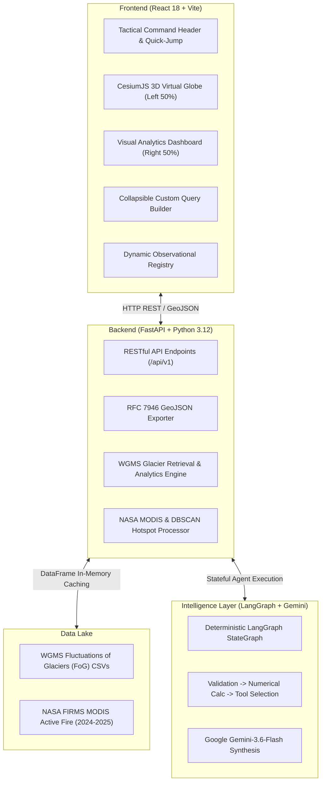

# EARTHPULSE — Interactive Geospatial Intelligence & Environmental Monitoring Platform

## 1. Executive Overview & Mission
**EARTHPULSE** is a mission-grade, interactive 3D Earth-observation and environmental analytics workstation. Built for environmental researchers, geoscientists, and climate analysts, the platform synthesizes verified multi-decadal cryospheric measurements from the **World Glacier Monitoring Service (WGMS)** and near-real-time satellite thermal anomaly detections from **NASA FIRMS MODIS** (Terra & Aqua).

The system pairs an interactive, high-fidelity **CesiumJS 3D Earth** on the left with an autonomous, visual-first **Scientific Analytics Dashboard** on the right, supported by an agentic **LangGraph + Gemini-3.6-Flash** intelligence pipeline.

---

## 2. System Architecture & Technology Stack



### Technology Highlights
- **Virtual Globe**: CesiumJS (Photorealistic terrain, WGS84 ellipsoid, atmospheric glow, starfield background, clamp-to-ground GeoJSON vector layers).
- **Frontend Framework**: React 18, Vite, TailwindCSS, Recharts (Time-series & bar distributions), Lucide Icons.
- **Backend Core**: FastAPI, Uvicorn, Python 3.12, Pandas, NumPy, Pydantic v2.
- **AI Agent Framework**: LangGraph, Google Gemini-3.6-Flash, with deterministic fallback reporting when quotas are constrained.
- **Spatial Clustering**: Scikit-Learn DBSCAN for geographic hotspot detection ($\epsilon$ in kilometers using Haversine metric).

---

## 3. Core Operational Modules

### A. Glacier Intelligence (WGMS Cryosphere Fluctuations)
- **Data Ingestion**: Direct integration with WGMS archives containing over 3,150 catalogued glaciers across 30+ countries.
- **Analytical Metrics**:
  - **Annual Mass Balance**: Multi-decadal historical balance measurements in millimeters water equivalent ($\text{mm w.e.}$).
  - **Front Variation**: Terminus advance, retreat, and stationary states in meters ($\text{m}$).
  - **Morphological State**: Elevation spans (minimum, mean, maximum), glacier length ($\text{km}$), and surface area ($\text{km}^2$).
  - **Regional Decadal Regimes**: Empirical calculation of modern-era ($\ge 2000$) mass loss percentages versus historical baselines.
- **Search & Global Resolving**:
  - Search by glacier name (e.g., *Adi Kailash*, *Silvretta*, *Aletsch*, *Hintereisferner*).
  - Search by WGMS Glacier ID (e.g., `3051`, `408`, `491`, `2921`).
  - Automatic cross-country resolving: Searches gracefully fall back globally if a user queries a glacier without changing the country selector.

### B. Thermal Anomaly Intelligence (NASA FIRMS MODIS)
- **Data Ingestion**: NASA FIRMS Active Fire and Thermal Anomaly Collection 6.1 (Ingested millions of detections for 2024 and 2025 across key benchmark regions: Singapore, Australia, Brazil, Canada, Indonesia, United States).
- **Analytical Metrics**:
  - **Fire Radiative Power (FRP)**: Radiative heat output measured in Megawatts ($\text{MW}$).
  - **Sensor Overpasses**: Dual-pass diurnal comparison between **Terra** (morning descending pass, EOS AM-1 at ~10:30) and **Aqua** (afternoon ascending pass, EOS PM-1 at ~13:30).
  - **Detection Confidence**: Distribution of high ($\ge 80\%$), nominal ($30\%-80\%$), and low ($< 30\%$) confidence observations.
  - **Severity Tiers**: Segmented breakdown into Critical ($\ge 50\text{ MW}$), High ($20-50\text{ MW}$), Moderate ($10-20\text{ MW}$), and Cold/Baseline ($< 10\text{ MW}$).
  - **DBSCAN Spatial Hotspot Clustering**: Spatial density clustering identifying contiguous clusters of active fire detections.

### C. AI Intelligence & Scientific Interpretation
- **Visual-First Design**: Rather than walls of generic markdown prose, the AI synthesis is decomposed into structured visual cards:
  1. **Key Scientific Observation**: Concise statement of empirical findings.
  2. **Historical Trend**: Multi-decadal retreat or radiative emission trajectory.
  3. **Scientific Implication**: Cryospheric water resource impacts or environmental combustion analysis.
  4. **Data Constraint / Caveat**: Strict adherence to scientific data integrity (e.g., noting WGMS observation gap years without fabricating interpolated values).

---

## 4. Key Interface Workspaces

1. **Tactical Command Header**:
   - Live backend health indicator (`API SYNCHRONIZED` / `DISCONNECTED`).
   - Module switcher (`Globe & Dashboard`, `Glacier Intelligence`, `Thermal Anomaly Intelligence`, `AI Intelligence`).
   - One-click global refresh control.

2. **Quick-Jump Geographical Navigation Strip**:
   - Instant camera flight to prominent monitoring zones:
     - *Glaciers*: Alps (Silvretta), Austria (Hintereis), Norway (Storbreen), Alaska (Taku), Sweden (Storglaciaeren), Himalayas, Iceland, Patagonia, Greenland, Antarctica.
     - *Thermal*: Singapore, Australia, Brazil, Canada, Indonesia, United States.

3. **Interactive CesiumJS 3D Earth (Left 50%)**:
   - Smooth animated camera flights with realistic pitch and altitude adjustments.
   - Glowing selection reticles with high-visibility target labels.
   - Dynamic GeoJSON vector styling (Cyan for cryospheric markers, Amber/Orange for thermal anomaly detections).

4. **Visual Analytics Dashboard (Right 50%)**:
   - **Numerical KPI Cards**: Distinct, module-segregated metric indicators.
   - **SVG Donut Rings & Segmented Proportion Bars**: Visualizing loss vs. gain percentages, terminus retreat distributions, and satellite overpass ratios.
   - **Interactive Recharts Visualizations**: Interactive hover tooltips, negative/positive color branching, and baseline reference lines.
   - **Dynamic Results Registry Table**: Clickable observational registry with live pagination and target selection.

---

## 5. Mathematical Formulations & Data Processing

### Glacier Mass Loss Percentage
$$\text{Loss Rate (\%)} = \left( \frac{\sum_{i=1}^{N} \mathbb{I}(B_i < 0)}{N} \right) \times 100$$
*where $B_i$ is the verified annual mass balance in $\text{mm w.e.}$, and $N$ is the number of monitored glacier observation years.*

### Terminus Retreat Percentage
$$\text{Retreat Rate (\%)} = \left( \frac{\sum_{j=1}^{M} \mathbb{I}(\Delta L_j < 0)}{M} \right) \times 100$$
*where $\Delta L_j$ is the front variation length change in meters, and $M$ is the count of empirical terminus surveys.*

---

## 6. How to Run & Verify

### Starting the FastAPI Backend
```bash
.venv\Scripts\uvicorn backend.main:app --host 127.0.0.1 --port 8000 --reload
```
- Interactive Swagger API Documentation: [http://127.0.0.1:8000/docs](http://127.0.0.1:8000/docs)
- Health Check: [http://127.0.0.1:8000/health](http://127.0.0.1:8000/health)

### Starting the Vite Frontend
```bash
cd "frontend/Globe+Dashboard"
npm run dev -- --host 127.0.0.1 --port 5173
```
- Active Platform UI: [http://127.0.0.1:5173](http://127.0.0.1:5173)

---

## 7. Project Structure Directory Map
```
EARTHPULSE/
├── backend/
│   ├── agent/                 # LangGraph workflow, nodes, and Gemini integration
│   ├── api/                   # FastAPI routes (glaciers, geospatial, modis, agent)
│   ├── core/                  # Configuration, logging, and environment settings
│   ├── data/                  # Ingested datasets and caches
│   ├── geospatial/            # GeoJSON RFC 7946 converters and MODIS spatial processor
│   ├── schemas/               # Pydantic v2 data models and API response contracts
│   ├── tools/                 # Analytical engines (WGMS retrieval, MODIS processor, DBSCAN)
│   └── main.py                # FastAPI ASGI application entrypoint
├── data/
│   └── raw/glacier_data/data/ # WGMS FoG CSV files (glacier, mass_balance, front_variation, state, event)
├── frontend/
│   └── Globe+Dashboard/
│       ├── src/
│       │   ├── components/    # Header, QuickJumpNav, MapLegend
│       │   ├── dashboard/     # UnifiedAnalysisReport, GlacierDetailView
│       │   ├── globe/         # EarthGlobe (CesiumJS 3D integration)
│       │   ├── hooks/         # useEarthpulseData (central pipeline & state controller)
│       │   ├── modules/       # Glacier and Thermal query builders & registries
│       │   └── services/      # api.js client
│       ├── package.json
│       └── vite.config.js
└── EARTHPULSE_OVERVIEW.md     # Comprehensive project architecture & operational documentation
```
